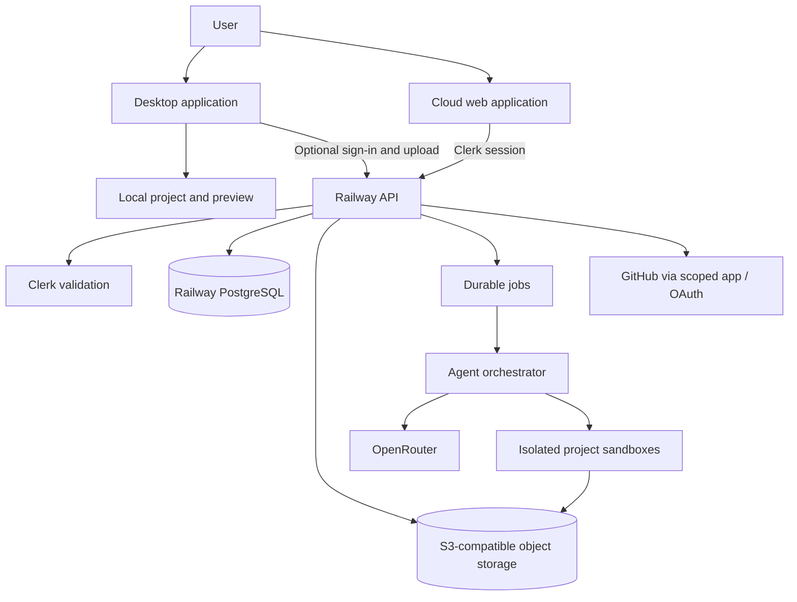
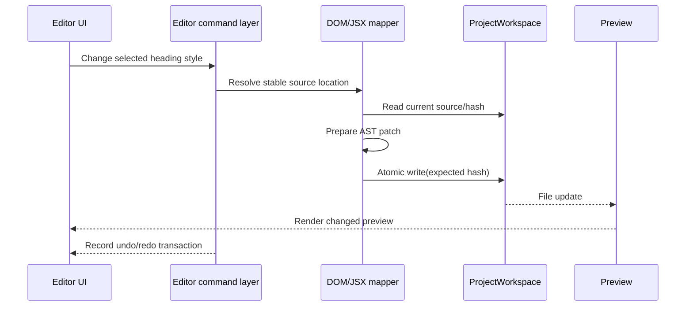

# allstudio — System Architecture

> **Status:** Proposed reference architecture · **2026-10-24**  
> **Scope:** shared local/cloud design editor, generation runtime, identity, storage, billing, and integration security  
> **Baseline:** Onlook public repository `onlook-dev/onlook` commit `423e2e924366419e418ee049093872d535eea41a` inspected for planning; validate the pin and build in implementation.

## 1. Architecture decisions

| ID | Decision | Status | Rationale |
|---|---|---|---|
| ADR-001 | Railway runs cloud web/API, job orchestration, and database infrastructure | **Locked** | Own API/worker lifecycles, PostgreSQL hosting, consistent deployment |
| ADR-002 | Clerk handles cloud identity and session lifecycle | **Locked** | Dedicated web and desktop authentication; local editing never requires login |
| ADR-003 | PostgreSQL with Drizzle for cloud app data | **Selected** | Relational permissions, revisions, run/credit ledger portability |
| ADR-004 | OpenRouter model routing for premium cloud agent | **Locked** | Provider abstraction and actual cost accounting |
| ADR-005 | Onlook-derived JSX/DOM editor, not wholesale SaaS fork | **Selected; spike required** | Strong code mapping; avoid Supabase and CodeSandbox lock-in |
| ADR-006 | Real source tree, not separate JSON canvas, is canonical | **Selected** | Round-trip edits and clean source export |
| ADR-007 | Electron desktop shell for V1 local runtime | **Recommended pending spike** | Node filesystem/process reuse and local editor parity |
| ADR-008 | Immutable snapshot/version sync before multiplayer | **Selected** | Conflicts safe and comprehensible; CRDT deferred |
| ADR-009 | Structured, bounded cloud jobs execute in isolation | **Required** | Generated code is untrusted; API/DB are never sandbox peers |
| ADR-010 | OpenDesign ideas/assets can be evaluated; no second full runtime | **Selected** | Reduce duplicate agent infrastructure |
| ADR-011 | Stripe billing and application-owned credit ledger | **Proposed** | Idempotent purchases, model usage vs allocation accounting |
| ADR-012 | Railway S3-compatible object storage for cloud project archives/assets | **Proposed** | Keeps V1 infrastructure consolidated; design against S3 API |

## 2. System context



**Trust boundaries:** local OS/project; public web client; authenticated API; production data; untrusted user-source sandboxes; third-party model services. Never route user-generated commands through the API's own shell.

## 3. Canonical project model

A project is a real, runnable source tree (V1: Next.js + Tailwind). Canonical files include `package.json`, `app/` or `src/app/`, components, CSS, static assets, and config. allstudio project metadata is additive, under `.allstudio/`:

```text
my-site/
  package.json
  src/app/page.tsx
  src/app/globals.css
  src/components/...
  public/...
  .allstudio/
    project.json       # project format, ID, supported framework, last local revision
    design-system.json # optional editor tokens, not a competing source of CSS truth
    DESIGN.md          # optional agent design contract
```

**Rules:** JSX/TSX/CSS are authoritative for rendered website state. `project.json` stores editor/tooling metadata only; never duplicate component tree into a private opaque database. Source mappings can be rebuilt from instrumentation and AST. Use schema versions and migration functions for `.allstudio/` metadata; never rewrite user source silently.

**Cloud storage:** PostgreSQL holds owner/workspace/project IDs, metadata, run status, ACL and revision index; object storage holds content-addressed immutable project archives, screenshots and assets. Do not store entire repositories in DB rows. A cloud project revision references hash, manifest, source commit (if any), and blob keys.

## 4. Shared editor and execution ports

The frontend imports interfaces and domain commands, never imports Railway/Clerk/NodeFs clients directly into editing managers.

```ts
export interface ProjectWorkspace {
  id: string;
  read(path: string): Promise<Uint8Array>;
  writeAtomic(path: string, bytes: Uint8Array, expectedHash?: string): Promise<string>;
  list(glob?: string): Promise<ProjectEntry[]>;
  watch(onChange: (change: ProjectChange) => void): Promise<() => void>;
  createSnapshot(message?: string): Promise<ProjectSnapshot>;
}
export interface PreviewRuntime {
  start(projectId: string): Promise<PreviewSession>;
  stop(sessionId: string): Promise<void>;
  capture(sessionId: string, viewport: Viewport): Promise<ArtifactRef>;
}
export interface AgentExecutor {
  run(request: AgentRunRequest): AsyncIterable<AgentRunEvent>;
  cancel(runId: string): Promise<void>;
}
```

These are **illustrative contracts**, not code already present in Onlook. Concrete adapters:

- `LocalProjectWorkspace`: validated project-root paths, real Node `fs`, file watchers, atomic temporary-file rename, local Git snapshots if available.
- `CloudProjectWorkspace`: cloud version + object storage manifest and sandbox checkout; writes to sandbox first, then commits immutable archive/version.
- `LocalPreviewRuntime`: child process with restricted scope/port; Node-supported toolchain; WebView/iframe instrumented DOM; structured startup errors.
- `CloudPreviewRuntime`: ephemeral isolated preview environment, fixed TTL, authenticated or signed preview URLs, restricted network.
- `LocalAgentExecutor`: optional user-provided key or approved installed runtime, executed with scoped workspace access.
- `CloudAgentExecutor`: usage-metered workflow invoking OpenRouter and a temporary sandbox.

All writes are path-normalized: reject `..`, symlink traversal outside project root, absolute paths outside scope, and unsafe archive extraction. File writes are transactional/atomic at the adapter boundary; longer multi-file edits use stage + validate + commit snapshot.

## 5. Editor write path



**Undo/redo:** commands carry before/after patches and expected source hashes. If an external developer changes the file concurrently, invalidate/rebase or surface a conflict; do not blindly overwrite. Use AST transforms with preservation of unrelated formatting where practical, and test idempotence.

## 6. Local-first operation

**Local stack:** Electron main process mediates filesystem, command execution and browser preview, with a sandboxed renderer and hardened IPC. A local index (SQLite if needed) stores recent-project references, UI preferences and checkpoints; the **source folder remains authoritative**.

Local operations require no Clerk session, Railway account, project upload, or online license check. A project with dependencies installed must open, preview and save while offline. Model invocations to external APIs are not offline; display this clearly.

**Security:** Electron context isolation enabled, node integration disabled in UI renderer, minimal preload IPC surface, CSP, explicit file-picker grants, no broad `executeCommand` through renderer; when importing untrusted project code, use restricted child-process privileges and prompt before running scripts.

## 7. Hosted cloud architecture

Suggested Railway services (separate deploy targets):

1. **web**: Next.js UI, Clerk integration, server-rendered workspace. No sandbox or production DB credentials in client JS.
2. **api**: Node/TypeScript HTTP/tRPC boundary for projects, revisions, credit ledger, GitHub, sync and MCP. Verifies Clerk tokens and project membership.
3. **agent-worker**: durable queue consumer/orchestrator, OpenRouter routing, design plan, screenshot quality loop, run cancellation.
4. **postgres**: Railway PostgreSQL with pooling and enabled backup/PITR. App DB role least-privilege; migration role separate.
5. **storage**: S3-compatible project archives/assets and screenshots. Presigned limited URLs, content hashing.
6. **sandbox provider**: dedicated ephemeral isolated code execution (choose provider in spike); do **not** run arbitrary customer Next.js projects inside the persistent API or shared agent worker container.

Start queue implementation with PostgreSQL-backed job leasing/transactional outbox if scale allows; adopt a separate Redis queue when measurement warrants it. Worker counts and retry strategies driven by actual workload, not prematurely guessed traffic.

**Clerk:** verify session JWT/server-side via supported SDK or JWKS; map `clerk_user_id` to stable application user ID; derive workspace/project permissions from app DB. Async Clerk webhooks are reconciliation signals, not the sole source of truth for authorization. For desktop cloud sign-in, use Clerk's documented Electron integration; local-only mode bypasses it.

## 8. Cloud generation and quality loop

```mermaid
sequenceDiagram
  participant C as Client
  participant A as Railway API
  participant DB as Postgres / credits
  participant J as Queue / Worker
  participant M as OpenRouter
  participant S as Isolated sandbox
  C->>A: Create generation (brief, budget, idempotency key)
  A->>DB: Authorize project, reserve credit budget
  A->>J: Durable job(runId, revisionId)
  A-->>C: Run ID + stream endpoint
  J->>M: Plan direction and code patches
  J->>S: Apply patches and render
  S-->>J: Screenshots, build diagnostics
  J->>J: Critique; bounded iterations
  J->>DB: Settle actual usage, release remainder
  J->>A: Commit immutable project revision
  A-->>C: Editable project and artifact references
```

Status lifecycle: `queued → preparing → planning → generating → rendering → evaluating → finalizing → completed | failed | cancelled | budget_exhausted`. Every event has an ID and monotonic sequence number; event stream reconnects from last event. Repeated delivery cannot duplicate patches or bill usage twice.

**Safety:** redact prompts/logs; validate model-suggested file modifications; hard limit tokens, wall time, tool calls and output bytes; kill sandbox on cancel/timeout; restrict sandbox egress and filesystem mounts. A generated website can request dependencies, but installer/build access is policy-controlled.

## 9. Credit and payment invariants

Credit account belongs to **billing workspace**, not merely a Clerk session. Tables (illustrative): `credit_accounts`, `credit_grants`, `credit_reservations`, `credit_ledger_entries`, `agent_runs`, `provider_usage`, `billing_customers`, `billing_subscriptions`, `webhook_events`.

- `available = posted_grants - settled_debits - active_reservations - expired_grants` (use unambiguous signed ledger rules).
- Reserve expected worst-case credits **within a database transaction** before a run is queued; never allow negative available balance.
- Model calls get idempotency identifiers; record raw provider usage/cost evidence and conversion version.
- Settle actual usage after execution; refund unused reserve transactionally. Retries may not double-debit.
- Stripe webhooks must verify signature, deduplicate event ID, and update subscription/credit state transactionally.
- Soft warning before budget exhausts; hard stop at limit. Avoid implementing “unlimited generations.”

## 10. Authentication, authorization and secrets

- Desktop local: no account required. Local BYOK secrets reside in OS keychain/secure storage, never plain project files.
- Cloud web/desktop: Clerk controls identity; API maps identity to app user and verifies workspace membership, roles, and individual project sharing on **every** read/write.
- API service has credentials to PostgreSQL/object storage; isolated preview code does not. Use short-lived scoped artifact URLs and brokered tools for needed assets.
- Encrypted provider credentials if BYOK is ever available in cloud; do not log API keys. Prefer no storage of third-party keys in V1 cloud.
- GitHub installation tokens are short-lived, restricted to approved repositories; write actions require explicit user confirmation.
- MCP credentials scope to user/workspace/project/tool; rate limits are enforced by API and cannot be overridden by the prompt.
- Railway storage buckets currently do not supply S3-style object versioning or automatic bucket server-side encryption; immutable content-addressed keys and application-level encryption for sensitive data are mandatory design considerations.

## 11. Synchronization and conflicts

V1 uses **explicit snapshot sync**, not continuous multiplayer. `project_id` is stable; each upload/download includes base `revision_id`, manifest hash, and an immutable object key. Conditional update succeeds only if server head equals base. Otherwise respond with conflict and allow download remote / upload fork / manual file merge. Never auto-overwrite. Offline edits are retained until acknowledged and survive app restart.

## 12. Database boundaries / core entities

`users (id, clerk_user_id unique)`, `workspaces`, `memberships`, `projects`, `project_revisions (parent_id, manifest_hash, object_key)`, `assets`, `agent_runs`, `agent_events`, `credit_accounts`, `credit_reservations`, `credit_ledger_entries`, `provider_usage`, `integrations`, `github_installations`, `idempotency_keys`, `webhook_events`, `audit_events`. Use tenant IDs and foreign keys; define unique constraints on `(project_id, revision_seq)`, provider event IDs, and command idempotency keys.

Do not use Postgres as the only storage for source blobs. No cross-tenant query without application authorization, and test for insecure direct object references (IDOR).

## 13. Observability, recovery and operational readiness

Structured logs + trace IDs across API/queue/worker/sandbox; Sentry for exceptions, PostHog for consent-aware product usage. Monitor queue age, run costs, failures, credit leakage, cloud preview TTL and orphaned sandboxes. Avoid collecting project source, prompts or screenshots by default. Configure Railway database backups/PITR; perform quarterly restoration drills once public. Storage snapshots require their own retention and backup policy; DB backup alone cannot restore code archives.

## 14. Validation plan

| Test | Proof |
|---|---|
| Offline smoke | Local project opens, edits, previews and exports without internet |
| Editor mapping | Source selection and transformations correct across supported fixtures |
| API IDOR | A user's token cannot read/edit another workspace/project; verify every router |
| Sandbox breakout | Untrusted user code cannot access production secrets, services, or other tenants |
| Billing retry | Concurrent/repeated run and webhook events never double-charge |
| Sync divergence | Base-revision mismatch causes conflict, never overwrite |
| Recovery | Restore Postgres plus project archives into staging and reopen a site |
| Build artifacts | Cloud-generated outputs compile and reopen locally with the shared editor |

## 15. Key technical dependencies and unresolved choices

- Confirm Electron packaging, Clerk Electron sign-in, and local process security in a spike.
- Select isolated sandbox vendor/technology based on startup cost, security, outbound policy, build support, and cleanup.
- Establish stable AST/DOM mapping across React Server Components/Next.js updates.
- Decide project archive and preview retention periods after cost/security review.
- Decide own-code license / open-core disclosure before publishing.

## References

- Onlook source: https://github.com/onlook-dev/onlook
- Railway services: https://docs.railway.com/services
- Railway PostgreSQL: https://docs.railway.com/databases/postgresql
- Railway buckets: https://docs.railway.com/storage-buckets
- Clerk JWT validation: https://clerk.com/docs/guides/sessions/manual-jwt-verification
- Clerk Electron SDK listing: https://clerk.com/docs
