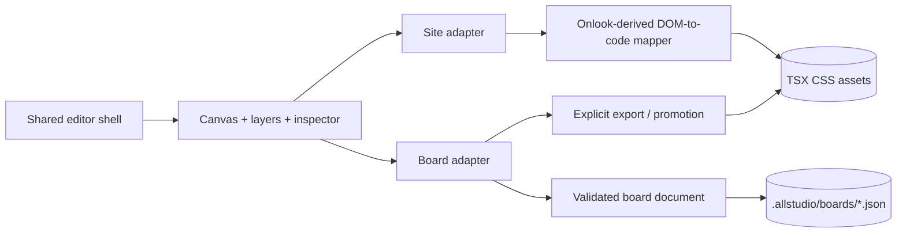
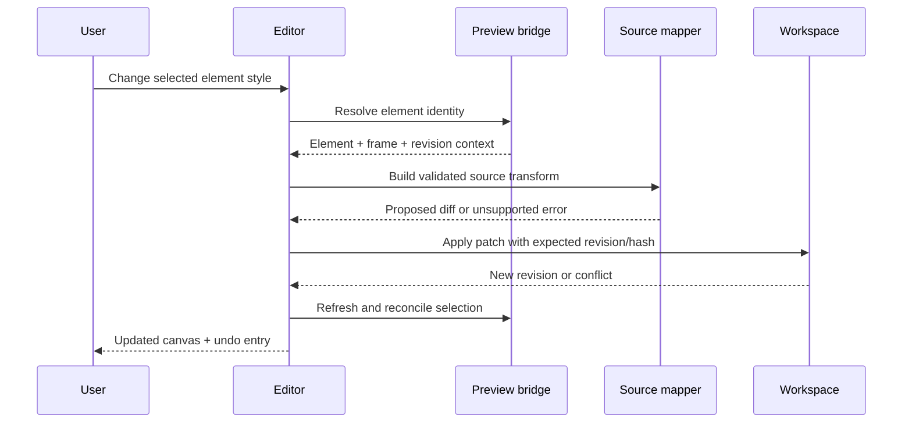
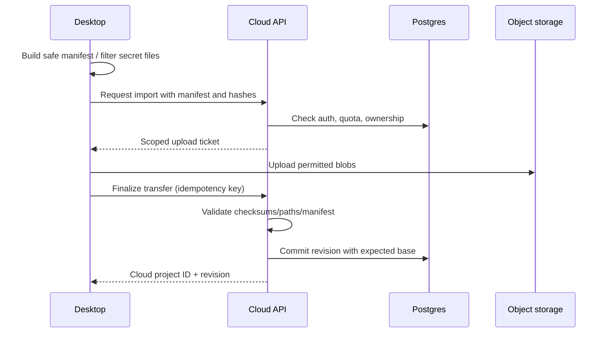

# allstudio — Codebase Architecture

> **Status:** Proposed implementation architecture; approved product and platform boundaries, unvalidated implementation details  
> **Version:** 0.2 (architecture redesign) · **Date:** 2026-10-24  
> **Product:** allstudio · [allstudio.dev](https://allstudio.dev)  
> **Companion:** [REPOSITORY_ARCHITECTURE.md](./REPOSITORY_ARCHITECTURE.md)  
> **Authority:** Agreed decisions in this document supersede the relevant assumptions in the original v0.1 drafts; the original PRD, system architecture, Onlook plan, and tech stack have **not** yet been updated.

## 1. Executive architecture decision

allstudio is an **open-core, local-first, web-native design studio**. Its desktop editor aims for Paper-like creative exploration and Framer-like website production, without claiming either product's entire feature set in V1. The public application must be a serious, self-sufficient professional editor even when offline. The private hosted application adds managed projects, premium autonomous generation, and consumption-based credits.

**Locked decisions**

- Desktop: **Electron** (macOS-first V1, other OS builds after validation).
- Cloud infrastructure: **Railway**; cloud identity: **Clerk**; relational data: **PostgreSQL + Drizzle**.
- AI inference for the managed service: **OpenRouter**. Local assisted AI supports BYOK/authorized integrations.
- Licensing/model: **Apache-2.0 public editor**, **proprietary private cloud**, with the public/private repository boundary described below.
- Code foundation: **fork Onlook first; verify end-to-end editor behavior; extract only proven, coherent modules**. OpenDesign is an optional reference, not a second runtime dependency. Penpot is not required for V1.
- Product: web-native creative canvas plus code-aware editing, focused initially on websites and web interfaces; **local ↔ cloud project transfer is P0**; no real-time multiplayer in V1.
- Deployment layout: **one public editor monorepo plus one private hosted-backend monorepo**; the latter consumes versioned public packages. Neither public nor private code should be duplicated across repositories.

**Non-negotiable invariants**

1. Creating, opening, editing, saving, and exporting a local project never requires a Clerk session, Railway, or access to `allstudio/cloud`.
2. The desktop and hosted editor use **the same versioned editor package**, not two forks of UI/editor logic.
3. A user can obtain complete editable source and assets from a cloud project and reopen them locally without the proprietary cloud agent.
4. Site-source editing and exploratory board editing have **explicitly different persistence models**; there is no claim of general lossless conversion between arbitrary freeform compositions and React source.
5. Credentials, authorization, metering, and run execution are enforced by trusted server processes, never by client UI state.
6. Generated/user-supplied code executes in a constrained context, not with Railway API, database, Clerk secret, or billing credentials.

## 2. System contexts and trust boundaries

```mermaid
flowchart TB
  subgraph PUBLIC[Public Apache-2.0 code]
    Desk[Electron desktop UI]
    Core[@allstudio/editor]
    Project[@allstudio/project]
    Protocol[@allstudio/protocol]
    Native[Electron main + local workspace adapter]
    Desk --> Core
    Desk --> Project
    Desk --> Protocol
    Desk --> Native
  end
  subgraph PRIVATE[Private allstudio/cloud]
    Web[Next.js hosted app + API]
    DB[(Railway PostgreSQL)]
    Blob[(Object storage)]
    Jobs[(Durable jobs)]
    Worker[Premium agent worker]
    Sandbox[Isolated preview/build sandbox]
    Web --> DB
    Web --> Blob
    Web --> Jobs
    Jobs --> Worker
    Worker --> Sandbox
  end
  Native --> Files[(User project directory)]
  Native --> LocalPreview[Local preview process]
  Desk <-->|Authenticated HTTPS API| Web
  Web -->|imports pinned packages| Core
  Web -->|imports pinned packages| Project
  Web -->|implements public protocol| Protocol
  Worker --> Router[OpenRouter]
  Web --> Clerk[Clerk identity]
```

Boundary notes:

- The Electron **renderer** is unprivileged; its **preload** exposes minimal typed requests; the **main** process validates each request and owns filesystem/process access.
- The **project preview** is potentially hostile, even if the user chose the project. Its DOM instrumentation must not grant the preview native IPC, API secrets, or arbitrary filesystem access.
- The **Next.js API** is the public-facing control plane; **agent workers** are backend actors; **execution sandboxes** run untrusted builds/previews. The worker and sandbox are distinct trust zones.
- Proprietary code can import public packages; public packages **never** import `allstudio/cloud` implementation or build-time secrets.

## 3. Two document surfaces within one editor

The term **web-native design studio** is deliberate. allstudio offers one visual workspace shell (pages/frames, canvas, layers, inspector, tokens, assets, history) with two edit surfaces—not two disconnected products.

### 3.1 Site surface: code-backed production editing (V1 primary engineering path)

- Supports a verified subset of **Next.js + React + Tailwind CSS** projects initially.
- **Canonical representation:** actual TSX/JSX/CSS/source files in the user's project directory or cloud workspace.
- **Derived representation:** preview DOM, layer tree, selection boxes, style inspector, source map, transient editor state.
- A user command resolves a DOM node to a source location, performs a safe AST/CSS transformation, validates expected revision/hash, writes a patch, refreshes preview, and records undo history.
- Dynamic expressions, complex component boundaries, unknown CSS runtime behavior, and unsupported frameworks must fail explicitly rather than silently rewrite the wrong source.
- The cloud agent returns source files/artifacts that the *same site editor* can inspect and modify.

### 3.2 Board surface: Paper-inspired creative exploration (bounded V1 scope)

- Supports a **limited web-native artboard**: frames, text, image, simple shape/block, grouping, basic positioning, color/type/spacing and preview at selected viewports.
- **Canonical representation:** portable versioned JSON board documents under `.allstudio/boards/` (plus referenced local assets). No proprietary backend required.
- **Derived representation:** browser-rendered HTML/CSS with explicit frame/artboard coordinates. This is **not** the canonical JSX/TSX of a website.
- A board may be promoted/exported to a **new site scaffold** via a deliberate, testable conversion step. After export, the code-backed result becomes independent. Not every freeform board property maps to a responsive site.
- V1 does **not** promise Figma-class vectors, infinite extensible object types, shared multiplayer cursors, arbitrary SVG path editing, or perfect two-way board ⇄ source round trips.

### 3.3 Shared UI, separate edit adapters



**Why this separation?** Onlook's parser addresses code editing; it is not a complete freeform document engine. Using a separate, narrowly defined board schema keeps Paper-like exploration achievable without corrupting production source files or inventing a fake universal design model. The editor shell can share typography, asset, selection and rendering utilities between surfaces where behavior genuinely matches.

### 3.4 V1 sequencing for the two surfaces

Build the **site editing vertical slice first** to validate Onlook. After it works locally, add the **minimal board surface** without breaking source-backed editing. Both should exist by the intended design-studio beta, but completion is gate-based rather than tied to speculative dates.

## 4. Public package contracts

Initially limit public reusable packages to three. Everything else can be a submodule until a real independent reuse/deployment need arises.

| Package | Owns | Must not own |
|---|---|---|
| `@allstudio/editor` | Canvas UI, site/board editors, source mapping, selection, commands, render/preview adapters, style inspector | Electron native filesystem, Clerk, Railway, billing, server-only AI |
| `@allstudio/project` | Project manifest, board schema, source file/revision interfaces, snapshots, import/export validation, portability rules | UI framework, auth provider, storage vendor, premium agent |
| `@allstudio/protocol` | Versioned HTTPS API schemas, event types, error codes, typed cloud client | Backend business logic, secrets, internal private job prompts |

Keep shared functions pure where possible. Expose runtime interfaces rather than importing `node:fs` into a React package.

### 4.1 Example project model (illustrative, not yet final schema)

```ts
export type ArtifactKind = 'site' | 'board';

export interface ProjectManifestV1 {
  schemaVersion: 1;
  projectId: string;               // stable UUID; no auth dependency
  name: string;
  artifacts: Array<{
    id: string;
    kind: ArtifactKind;
    path: string;                   // relative, normalized, inside root
  }>;
  sourceFramework?: 'nextjs-react';
  createdAt: string;
}
```

Files on disk:

```text
my-project/
├── app/ or src/                  # website source, if site artifact
├── components/
├── public/                       # images/fonts owned by project
├── package.json
└── .allstudio/
    ├── project.json              # portable project metadata
    ├── boards/                   # board docs, if applicable
    │   └── moodboard.board.json
    └── revisions/                # local optional checkpoints (bounded)
```

Do **not** require `node_modules`, `.next`, API keys, local private auth state or `.env*` secrets in exports. Website source is the canonical model for `site`; board JSON is canonical for `board`.

### 4.2 Workspace adapters

```ts
export interface ProjectWorkspace {
  readFile(path: string): Promise<{ bytes: Uint8Array; sha256: string }>;
  writeFile(input: {
    path: string;
    bytes: Uint8Array;
    expectedSha256?: string;
  }): Promise<{ sha256: string }>;
  listFiles(): Promise<string[]>;
  createCheckpoint(reason: string): Promise<{ revisionId: string }>;
  getCapabilities(): Promise<{ preview: boolean; nativeFiles: boolean }>;
}
```

- Desktop implements using a granted **project-root-scoped local adapter**.
- Cloud implements via an **authorized remote workspace client** backed by the private service.
- Avoid a broad `executeShell(command: string)` contract. Preview/tool execution is a separately permissioned capability.
- `expectedSha256` enforces optimistic single-file writes; multi-file changes require a staged revision transaction with recovery/rollback behavior specified and tested.

### 4.3 Edit-command lifecycle



Code edits need preconditions, AST formatting preservation as feasible, parse/build feedback, and explicit conflict resolution. Selection IDs may become stale after hot reload; do not assume stable DOM node identities forever.

## 5. Desktop architecture (public Electron app)

```text
apps/desktop/src/
├── main/                 # application lifecycle, safe native operations
│   ├── windows/
│   ├── ipc/
│   ├── projects/         # local workspace adapter
│   ├── previews/         # local dev-server process supervisor
│   ├── credentials/      # OS-backed secure storage
│   └── updates/
├── preload/              # typed, minimal contextBridge API
├── renderer/             # shared editor package + desktop shell
└── auth/                 # OPTIONAL hosted-account sign-in adapter
```

**Security defaults:** `contextIsolation: true`, `nodeIntegration: false`, renderer sandboxing, CSP, restrictive navigation/window policy, IPC sender and payload validation, explicit file-root allowlists, safe custom app protocol, per-project permission prompts for script execution. A local Next.js development server is an arbitrary Node process and **cannot be considered sandboxed just because Electron renderers are sandboxed**. Warn and request explicit consent before running install scripts or unknown project commands; scrub environment variables and isolate preview browser partitions.

**Preview isolation:** do not load an untrusted page in the privileged renderer that has allstudio's preload bridge. Prefer a separate unprivileged preview webContents/window/partition with no native bridge and tightly validated cross-context messages. Navigation, external link opening, downloads and permission requests must be controlled. Restrict DOM injection to known local preview origins and validate `postMessage` origins/nonces and event envelopes.

**Local persistence:** project source files are authoritative. An optional SQLite database or simple app config may index recent workspaces, window state, and caches; it must not be a mandatory second copy of project source. Save through temp-file + fsync/rename where supported, with recovery journal for multi-file transactions.

**Offline:** initial open, edit, save, and reopen must work without the network for supported projects with installed dependencies. BYOK inference is separately online unless the user has a supported offline model; cloud login and syncing never gate local operation.

**Cloud account:** optional Clerk auth adapter; Clerk's Electron SDK has beta status, so keep sign-in implementation behind a replaceable adapter and verify packaged macOS OAuth/deep links, token storage, logout and offline behavior. Never ship Clerk secret keys in Electron.

## 6. Private cloud architecture (`allstudio/cloud`)

### 6.1 Control plane: Next.js on Railway

Start with an API implemented through **Next.js route handlers** and server-side domain modules. A route validates inputs, resolves Clerk identity and app authorization, calls a service, and returns a typed response. It must not contain substantial billing or job implementation logic.

Initial modules:

- `identity`: Clerk session verification; app user reconciliation; never trust client-supplied `userId`.
- `authorization`: workspace membership and per-project ACLs. Every read/write is scoped server-side.
- `projects`: project metadata, import/export, revision CAS, object store references, upload validation.
- `storage`: bucket adapter and short-lived signed uploads/downloads; no broadly public customer project buckets.
- `credits`: Stripe webhook processing, double-entry-like immutable ledger, reservations, refunds/reconciliation, idempotency keys.
- `jobs`: generation submission, cancellation, durable queued state, authenticated progress events.
- `integrations`: GitHub OAuth/App permissions, explicit repo import/export flows.
- `mcp`: narrow project-scoped tools with role enforcement, quotas, and usage budgets.

### 6.2 Data ownership / service separation

Private Postgres is authoritative for identity mappings, ownership, subscriptions, credit balances/ledger, job states, revision metadata, and storage object keys. **Large source trees and assets** live in object storage rather than large SQL blobs. Versioned immutable snapshots are content-addressed where possible. Drizzle schema/migrations live with the cloud backend, not in the public editor.

Provisional tables: `users`, `workspaces`, `workspace_memberships`, `projects`, `project_revisions`, `artifacts`, `storage_objects`, `agent_runs`, `agent_run_events`, `credit_accounts`, `credit_ledger_entries`, `credit_reservations`, `subscriptions`, `webhook_events`, `integration_connections`, `project_transfers`.

Tenant/project authorization is mandatory even if database-level RLS is not used. If using pooled Postgres with superuser-style application credentials, DB-level RLS alone cannot be treated as complete isolation.

### 6.3 Generation plane: private worker + sandbox

- Dedicated long-running worker when generation first becomes usable; it pulls leased jobs from a durable queue. Start with Postgres-backed job/outbox semantics; switch to Redis/managed queues only if load characteristics justify it.
- Worker orchestrates `brief → art direction → design specification → generation → screenshot render → critique → bounded repair → editable artifact`.
- Cloud uses OpenRouter API under server-side credentials. Model-routing policy, curated systems, critique rubrics, and internal prompts are proprietary private modules.
- Generated projects execute in **ephemeral isolation** with CPU/memory/disk/time quotas, outbound network restrictions, ephemeral credentials, and TTL. Sandboxes receive no main DB URL, Clerk secret, Stripe secret, OpenRouter master key, or other customers' data.
- Run state is durable and idempotent: `created → credit_reserved → queued → running → validating → completed | failed | cancelled`. A retry must not double-charge or publish duplicate revisions.
- Only validated outputs are promoted to durable project versions. Maintain provenance and a reproducible manifest for artifacts.

### 6.4 Credit ledger principles

1. Estimate maximum budget before accepting a job.
2. Atomically reserve an allowed credit amount under a transaction/lock; reject when insufficient.
3. Execute with enforced token/tool/time/sandbox ceilings; client-side warnings alone do not count as caps.
4. Record provider usage and non-model infrastructure costs with durable event IDs.
5. Reconcile actual charges and release unused reserve **exactly once**, including cancellation and crash recovery.
6. Stripe webhooks are signature-verified, persisted, idempotent, and separately reconciled.

Public protocol exposes prices/estimates, run states and the user's ledger summary, never internal cost multipliers or billing secrets.

## 7. Cloud API and cross-repository protocol

The private backend **implements** the public, versioned `@allstudio/protocol` package. The public desktop and hosted browser clients use it; the protocol package must be vendor-neutral (no Clerk secret, Drizzle schema or Railway service IDs).

Illustrative V1 endpoints (subject to OpenAPI/Zod contract review):

| Method | Path | Purpose |
|---|---|---|
| `GET` | `/api/v1/me` | Cloud session/account summary |
| `GET` | `/api/v1/projects` | Authorized project list |
| `POST` | `/api/v1/projects/imports` | Validate, stage and initiate a project transfer |
| `POST` | `/api/v1/projects/{id}/revisions` | Commit a snapshot with expected base revision |
| `GET` | `/api/v1/projects/{id}/exports/{rev}` | Signed, complete editable export |
| `POST` | `/api/v1/agent-runs` | Validate brief, cap budget, reserve credits, enqueue run |
| `GET` | `/api/v1/agent-runs/{id}` | Durable run state and bounded events |
| `POST` | `/api/v1/agent-runs/{id}/cancel` | Best-effort cancellation with reconciliation |
| `GET` | `/api/v1/credits` | User-visible balance and entries |

For streaming, use authenticated SSE or a similarly well-defined event transport; **persist events** so clients can reconnect after disconnection. Include `protocolVersion`, stable request IDs, error codes (`UNAUTHORIZED`, `FORBIDDEN`, `CONFLICT`, `UNSUPPORTED`, `LIMIT_EXCEEDED`, `INSUFFICIENT_CREDITS`), and pagination/rate-limit contracts.

**Cross-repo release rule:** private `allstudio/cloud` consumes pinned immutable releases of `@allstudio/editor`, `@allstudio/project`, and `@allstudio/protocol`. Avoid copying code across repositories, symlinking to a developer's disk, or depending on mutable `main` as production input. Public-to-private breaking changes require compatible upgrade tests and explicit version coordination.

## 8. Local ↔ cloud transfer (P0)

Define **reliable explicit transfer**, not full background sync or multiplayer.



**Upload:** normalize paths, deny `..`, symlink escapes and zip bombs, explicitly exclude `.env*`, token files, node_modules, Git credentials, build caches, secrets and OS keychain data; present an upload summary. Ensure object promotion and SQL revision commit can recover from partial failures.

**Download:** return a complete project with source, assets and `.allstudio` manifest; verify hashes; export must be usable without cloud auth afterward. Files created by premium cloud generation are owned/exportable by the user under the product's terms.

**Conflicts:** supply base-revision ID; on mismatch return `409 CONFLICT` with both revision identifiers and preserve remote/local changes for explicit resolution. No silent last-write-wins. **Continuous sync, CRDT, and simultaneous writers are post-V1.**

## 9. Local BYOK, MCP and GitHub boundaries

- **BYOK:** store keys using OS-backed secure storage; per-provider credential permissions; expose only named, scoped edit operations. “Existing Claude/ChatGPT subscription” must be described as supported **only through officially permitted integration paths**, not generic reuse of consumer-app credentials.
- **Local MCP:** inspect files/design objects and propose scoped patches; user permission required for writes/destructive actions and process execution. Untrusted MCP servers/tools cannot bypass local filesystem grants.
- **Hosted MCP:** authenticate the client, enforce workspace/project RBAC, concurrency, request ceilings, byte limits, per-run spending caps, cancellation; treat tool outputs as untrusted input.
- **GitHub:** first integration only; connect with least-privilege OAuth/App scopes, record repo binding separately from project data; import/export/commit only on explicit action; protect against malicious repos in preview/build step.

## 10. Quality attributes, tests and acceptance gates

| Gate | Evidence required | Blocking failure |
|---|---|---|
| G0 — Upstream Onlook | Pinned commit, license notices, cold build, traced select→edit→preview flow | Reimplementation based on untested assumptions |
| G1 — Local code edit | Valid fixture can select TSX element, edit text/style, save, undo and reopen offline | Source drift, unsupported edit corrupting file |
| G2 — Electron boundary | Native operations only via allowlisted IPC; preview cannot access app bridge or secrets | Arbitrary native API exposure |
| G3 — Creative board | Basic frames/text/images persist in portable board JSON; explicit export path | Board data depends on proprietary server |
| G4 — Shared editor | Same public editor version embedded in desktop and private Next.js host | Forked or copy-pasted editor implementation |
| G5 — Portability | Import and export round trip with assets/hashes; 409 conflict protection | Missing files/secrets leaked/overwrite |
| G6 — Premium agent | Bounded job produces a runnable, editable artifact; clear failure and cost state | Unbounded spending, untrusted code inside API |
| G7 — Payments | Concurrent reservation tests, duplicate webhooks, cancellation, lost-worker recovery | Duplicate charge, negative balances without policy |

Additional testing: unit tests for parsers, transforms and board schema; property/fuzz tests for path validation; integration tests for file watchers, build/preview adapters and DB transactions; Electron end-to-end/offline tests; cross-repo protocol compatibility tests; sandbox penetration/security tests; a small screenshot quality suite at desktop/mobile widths. Benchmark Onlook's extraction behavior before choosing advanced state management patterns.

## 11. Decisions explicitly deferred

- Specific sandbox vendor and network isolation mechanism; must pass security verification before accepting untrusted cloud projects.
- Electron Forge vs Builder, automatic updates, Windows/Linux packaging, code signing/notarization and release CDN details.
- Bun versus pnpm for allstudio after Onlook build/export compatibility checks. Onlook currently uses Bun; this is not yet an allstudio lock-in.
- Public package distribution registry, exact package namespace availability, and private dependency update tooling.
- Advanced CMS, domains, multiplayer, full vector editing, bidirectional real-time sync, custom LLM fine-tuning.
- Exact credit-to-cost exchange rate and cloud tier allocations; determine from unit-economic measurements.

## 12. Sources and provenance

- Onlook repository: https://github.com/onlook-dev/onlook — inspect and pin upstream sources; refer to `ONLOOK_INTEGRATION.md` for extraction candidates. Previously inspected upstream baseline: `423e2e924366419e418ee049093872d535eea41a` (must reverify on checkout).
- Electron security checklist: https://www.electronjs.org/docs/latest/tutorial/security
- Clerk Electron SDK (beta): https://clerk.com/docs/reference/electron/overview
- Railway monorepo deployments: https://docs.railway.com/deployments/monorepo
- Apache License 2.0: https://www.apache.org/licenses/LICENSE-2.0

This is an architecture proposal, **not a claim that the repositories, packages, cloud service or security controls have been implemented**.
