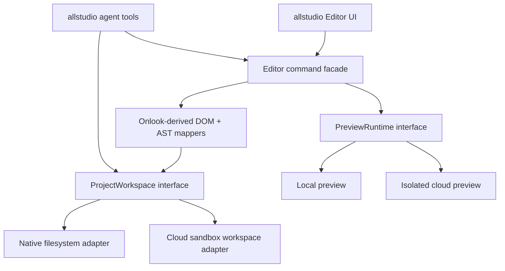

# allstudio — Onlook Source Integration Plan

> **Status:** Source-audited implementation proposal · **2026-10-24**  
> **Upstream:** https://github.com/onlook-dev/onlook  
> **Inspected main SHA:** `423e2e924366419e418ee049093872d535eea41a`  
> **Policy:** verify pinned SHA, licenses, APIs and build locally before extraction. Paths below describe the inspected public source, not Onlook's separate current hosted product.

## 1. Decision

Use **Onlook as the primary source for browser DOM ↔ JSX/TSX round-trip editing** in supported Next.js + Tailwind projects, **not as allstudio's complete application**. Preserve its source-editing architecture while replacing service-specific assumptions with adapters for local filesystem/preview and Railway cloud workspaces.

Do not rely on a hypothetical “already supported local backend” in the modern Onlook monorepo. The inspected `NodeFsProvider` is materially unfinished and returns empty/placeholder results for essential operations. Onlook's own README identifies the public repository as the earlier Next.js/Tailwind editor, separate from its newer hosted early-access product.

## 2. Verified upstream inventory

| Source path | Inspected capability | Action | Notes |
|---|---|---|---|
| `packages/parser/src` | JSX/TSX parser, source IDs, template-node and formatting helpers | **Extract/adapt** | High-value source mapping; private monorepo package with `@onlook/models` dependency |
| `packages/parser/src/code-edit` | Code transformations | **Extract/adapt** | Test Babel/AST behavior on supported Next/React fixtures |
| `apps/web/client/src/components/store/editor/engine.ts` | Main MobX editor composition | **Refactor** | Coupled to app/project/branch/sandbox/PostHog dependencies |
| `apps/web/client/src/components/store/editor/{ast,canvas,element,style,text,insert,move,history,overlay,frames,pages,snap}` | Editor managers | **Selective extraction** | Maintain coherent manager interface; don't cherry-pick without dependencies |
| `apps/web/client/src/components/store/editor/{branch,sandbox,chat,api}` | Server-bound state and orchestration | **Replace/bridge** | Remove Supabase/remote sandbox assumptions as needed |
| `apps/web/preload` | Preview instrumentation | **Adapt** | Harden postMessage origin/frame checks, version with editor |
| `packages/penpal` | Frame/window RPC communication | **Evaluate/reuse** | Explicit origin allowlist; browser-frame boundaries |
| `packages/file-system/src` | Browser filesystem abstractions | **Selective reuse** | Uses ZenFS/IndexedDB; not real desktop folder filesystem |
| `packages/code-provider/src/providers/nodefs/index.ts` | Intended native filesystem provider | **Implement, do not assume works** | Inspected file includes no-op read/write/list/watch/command bodies |
| `packages/code-provider/src/providers/codesandbox` | Sandbox provider | **Reference only** | Cloud execution moves behind allstudio adapter and dedicated isolation |
| `packages/ai/src` | Agent/chat/tools/prompt/apply/stream | **Reuse selectively** | OpenRouter/Vercel AI SDK patterns; remove Onlook-specific billing/runtime assumptions |
| `packages/git`, `packages/github` | Git/remote repo operations | **Adapt** | Review credentials, OAuth scopes and local/cloud flows separately |
| `packages/ui` | UI components | **Optional** | Original allstudio visual system takes precedence |
| `packages/db`, `apps/backend/supabase` | Onlook database / Supabase backend | **Do not migrate wholesale** | Rebuild app schema in Railway PostgreSQL, Clerk identity |
| `packages/stripe` | Billing utility | **Reference only** | New authoritative allstudio credit ledger / plan policies |
| `apps/web/client`, `apps/web/server` | App/UI/router | **Inspiration and temporary spike harness** | Gradual migration into allstudio web/desktop hosts |
| `onlook-dev/desktop` (separate older repo) | Legacy Electron local app | **Reference only** | Different era/codebase; inspect before copying |

**Source verification:** the SHA and inventory are based on the GitHub repository directories, `engine.ts`, `NodeFsProvider`, package manifests, README, and LICENSE viewed on 2026-10-24. Any copied file must have its own provenance recorded.

## 3. Critical coupling revealed by source

`EditorEngine` imports `CodeFileSystem`, `Branch`, `PostHog`, plus more than twenty concrete manager classes, and resolves `activeSandbox` and `fileSystem` through its branch manager. `initBranches()` initializes remote/workspace branch state. This is not a drop-in `npm install @onlook/editor` library. `@onlook/parser` is marked `private: true` and depends on `@onlook/models`.

The current `NodeFsProvider` implementation returns `success: true` without persisting data in `writeFile`, returns an empty string for `readFile`, empty arrays for `listFiles`, and placeholder terminal/watch implementations. It must be replaced with a **tested** native provider.

Onlook's baseline monorepo specifies Bun 1.3.1. Use its upstream toolchain for the initial build/proof, then agree on allstudio's pinned versions.

## 4. License, copyright, branding and dependency audit

- Upstream project root declares **Apache-2.0**. Keep license text, relevant attribution/patent/trademark notices and any applicable NOTICE content; prominently note changes to modified upstream files when distributing.
- Generate `THIRD_PARTY_NOTICES.md` (and machine-readable license inventory) from included packages, transitive dependencies, fonts, assets, sample templates and injected preview scripts. The root license does not automatically license every image/font/brand asset for reuse.
- Keep source attribution in extracted modules and document a provenance map: upstream path → upstream SHA → allstudio destination → modification summary.
- Do not redistribute Onlook name/trademark as allstudio's identity; do not assume proprietary hosted product code can be accessed/reused.
- OpenDesign's Apache-2.0 license similarly does not remove asset-level attribution/rights review. Choose allstudio's own license with counsel before public release; Apache-derived code obligations survive license decisions.

## 5. Extraction architecture

**Principle:** source editing code may depend on abstract `ProjectWorkspace` and `PreviewRuntime` contracts, but may **not** depend on Clerk, Supabase, Railway or a specific sandbox vendor. UI code may not execute unrestricted native filesystem calls. Avoid a broad event bus for everything; use typed commands and events.

### 5.1 Target package mapping

| Extracted concern | Destination | Mandatory decoupling |
|---|---|---|
| Babel source parsing/patches | `packages/source-mapper` | replace `@onlook/*` private-package imports with explicit internal deps |
| DOM inspection and frame instrumentation | `packages/preview-bridge` | origin validation, typed messages, explicit permissions |
| canvas + manager algorithms | `packages/editor-core` | inject workspace/preview/services, remove branch/sandbox singleton assumptions |
| inspector/layers and interaction controls | `packages/editor-ui` | separate presentation from editor data state |
| project file contract | `packages/workspace-contracts` | path canonicalization and optimistic concurrency |
| local provider | `packages/workspace-local` | implement fs, watch, process, git, atomic writes |
| cloud provider | `packages/workspace-cloud` | implement checkout, storage snapshot, upload/download |
| AI file edit tools | `packages/agent-tools` | explicit scope, validated patches, audit, cost enforcement |

## 6. Phased integration with exit criteria

### Phase 0 — Reproduce unmodified upstream

1. Record Git revision `423e2e924366419e418ee049093872d535eea41a`, license text, top-level manifests, package versions, and baseline errors.
2. Build/run the public repo in a disposable workspace **without product rewrites**; create a minimal Next.js + Tailwind sample.
3. Record working operations and system calls during select → style change → persisted code change.
4. Establish test fixtures and screenshots, with expected JSX diffs.

**Exit:** upstream runnable and reproducible, or blockers recorded with a downgrade path.

### Phase 1 — Parser/source mapper extraction

1. Port parser + minimum models with correct license/provenance.
2. Implement stable instrumentation IDs for preview-mode mapping without leaking dev markers into production export.
3. Validate JSX fragments, nested components, expressions, className merges, CSS/Tailwind interactions, formatting and no-op round-trip.
4. Expose `locateSource(elementId)`, `previewPatch(edit)`, `applyPatch(expectedHash)` via typed APIs.

**Exit:** tests show source mapping + safe edits without Onlook's cloud app; zero accidental edits in unrelated fixtures.

### Phase 2 — Local runtime and editor core

1. Implement actual `NodeFs` adapter and local process runner; atomic writes; watcher; symlink/path/zip protections.
2. Extract selection, style/text edit, layers, undo/redo and viewport preview in dependency order.
3. Set up Electron hardened IPC; point editor to local filesystem and preview URL.
4. Test fully disconnected after dependencies installed; restart and reopen project.

**Exit:** local, offline, editable Next.js project with working exported code.

### Phase 3 — Cloud adapter and agent

1. Build cloud project checkout/storage implementation and agent sandbox boundary.
2. Map editors to same commands; add Clerk identity, app-level ACL, OpenRouter tools with budget accounting.
3. Add screenshot critique/repair, generator-to-editor handoff, immutable project revisions.

**Exit:** same fixtures editable locally and in cloud, with safe project isolation and credit hard caps.

### Phase 4 — Remove obsolete upstream services

Audit references to `@onlook/`, Supabase clients, CodeSandbox SDK, Freestyle deployment, legacy analytics, and unused editor managers. Only remove source after feature parity tests pass. Pin retained fork against upstream SHA and document future upstream sync policy.

## 7. Risk and fallback matrix

| Risk | Early signal | Mitigation / fallback |
|---|---|---|
| Manager coupling makes extraction unstable | Requires large branch/sandbox state imports | Keep temporary fork harness; extract source mapper first and gradually strangler-refactor |
| AST edits break modern Next/React syntax | Source mapping wrong in fixture suite | Narrow supported components or preserve code-only editing fallback |
| Filesystem calls are no-ops | Editing works in iframe but vanishes after restart | Mandatory native provider implementation and offline persistence gate |
| Preview instrumentation is insecure | Untrusted frame can send edits | Origin/frame nonce, message schema validation, local scopes |
| Upstream licensing inventory incomplete | Unknown asset/component provenance | Block redistribution of questionable assets; use original replacements |
| Agent framework duplication | Two competing tool/stream/event protocols | Choose one orchestration contract and adapt tools behind it |
| Product diverges too far from source | Frequent upstream cherry-pick conflicts | Maintain a provenance log, minimize direct modifications, own interfaces and tests |

## 8. Cross-repository OpenDesign boundary

OpenDesign is a **reference and optional source of discrete, audited reusable packages** for design systems, skills and agent UX—not a dependency that runs in parallel to Onlook's complete editor/agent runtimes. If reusing a specific OpenDesign module, document an ADR, license audit, dependency scan and integration tests. Avoid two independent agents modifying the same project without one serial edit/transaction coordinator.

## 9. Mandatory tests / benchmark fixtures

- DOM-to-TSX selection under nested components and client/server boundaries.
- Text edit with expressions; refuse edits that would destroy dynamic runtime expressions.
- Tailwind utility change with responsive variants, conditional class expressions, and design tokens.
- Insert/delete/reorder across nested flex/grid layouts; undo/redo.
- External source edit while inspector is open: optimistic hash conflict, not silent overwrite.
- Unsupported framework and broken build: useful error and safe read-only fallback.
- Local restart/offline; write/read/rename/watch; malicious path traversal; symlink escape.
- Cloud project boundary, sandbox timeout, cancellation, limits and no double charge.

## 10. Decisions not to pretend are already solved

- A standalone Onlook editor package ready for production import.
- Complete `NodeFsProvider` implementation.
- Equivalent behavior between old Onlook Desktop and newer Onlook monorepo.
- Generic support for arbitrary HTML frameworks; V1 explicitly targets validated Next.js/Tailwind.
- Onlook's current hosted product source being publicly available.
- Legal right to reuse all example templates, stock images, icon sets or third-party bundled assets.

## 11. Evidence and links

- Public repo and explicit hosted/open-source distinction: https://github.com/onlook-dev/onlook
- Source parser: https://github.com/onlook-dev/onlook/tree/main/packages/parser/src
- Source editor engine: https://github.com/onlook-dev/onlook/blob/main/apps/web/client/src/components/store/editor/engine.ts
- Code provider stub: https://github.com/onlook-dev/onlook/blob/main/packages/code-provider/src/providers/nodefs/index.ts
- AI package: https://github.com/onlook-dev/onlook/tree/main/packages/ai/src
- Onlook Apache license: https://github.com/onlook-dev/onlook/blob/main/LICENSE.md
- Older desktop app: https://github.com/onlook-dev/desktop
- OpenDesign repository: https://github.com/nexu-io/open-design
