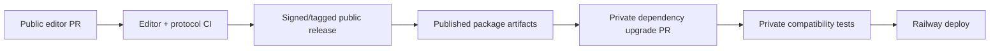

# allstudio — Repository Architecture & Engineering Workflow

> **Status:** Proposed repository design; architecture agreed in principle, no repositories or folders created  
> **Version:** 0.2 (architecture redesign) · **Date:** 2026-10-24  
> **Companion:** [CODEBASE_ARCHITECTURE.md](./CODEBASE_ARCHITECTURE.md)  
> **Decision:** **Option B open-core** — one public Apache-2.0 editor monorepo and one private proprietary cloud monorepo.

## 1. Design goals

The repository architecture must optimize for **small-team delivery now**, **credible open-source contribution**, and **managed-cloud product separation later**.

1. A contributor can clone and build the public Electron editor without a Clerk account, cloud source access, Railway environment, or private package token.
2. A hosted allstudio user uses the **same versioned public editing implementation** embedded in the private Next.js application; the code is not copied.
3. The private backend is never accidentally published through workspace dependencies, CI artifacts, generated SDKs, source maps, npm packages, or a public Git history.
4. Onlook is **validated before extraction**; extracted modules retain provenance, licenses, and regression tests.
5. Three public reusable packages at most to begin (`editor`, `project`, `protocol`); smaller responsibilities remain folders/modules.
6. Railway services, Clerk, PostgreSQL, billing and premium AI stay private; a dedicated worker is added when the first autonomous generation flow requires it.
7. Public and private release cadences may differ without breaking project portability.
8. Architectural concepts are created when a working feature needs them, not as dozens of empty package folders.

## 2. Repository map and ownership

| Repository | Visibility | License | Primary owner | Deploys |
|---|---|---|---|---|
| `allstudio/allstudio` | Public | Apache-2.0, preserving upstream third-party notices | Open-source editor maintainers | Electron app + public package releases |
| `allstudio/cloud` | Private | Proprietary (private license terms) | Cloud application maintainers | Railway-hosted Next.js service + eventual worker |

The names above are proposed GitHub repository slugs; do not treat them as created or claimed. **Two repositories do not mean microservices:** both are monorepos, and the private Next.js backend starts as a modular monolith.

### Ownership matrix

| Concern | Public editor repo | Private cloud repo |
|---|:---:|:---:|
| Electron main/preload/renderer | Own | Consume nothing |
| Site canvas, board canvas, editor UI | Own | Import released package |
| JSX/TSX parser, code-aware transforms | Own, derived from Onlook | Import released package |
| Portable `.allstudio` manifest/board format | Own | Import released package |
| Public HTTP protocol, error schemas, client | Own | Implement/consume release |
| Local BYOK helpers and scoped local MCP | Own | May interact through protocol |
| Hosted Next.js frontend and API routes | No | Own |
| Clerk session verification and tenant ACL | No | Own |
| Railway database schemas/migrations | No | Own |
| Subscription billing/credits/Stripe | No | Own |
| Managed OpenRouter keys, premium prompts, quality rubric | No | Own |
| AI execution, durable jobs, sandbox orchestration | No | Own |
| Private secrets and deployment settings | No | Own |
| Documentation and public roadmap | Own public-facing material | Own operational docs and private plans |

Public packages never reference `allstudio/cloud` as a source dependency. The private app may import public packages under Apache-2.0 and remain proprietary where licensing permits.

## 3. Public repository — initial target layout

```text
allstudio/                          # PUBLIC: allstudio/allstudio
├── README.md
├── LICENSE                         # Apache-2.0 full text
├── NOTICE                          # applicable upstream notices
├── THIRD_PARTY_NOTICES.md          # Onlook and other source provenance
├── CONTRIBUTING.md
├── SECURITY.md
├── CODE_OF_CONDUCT.md               # when community processes are established
├── AGENTS.md                        # coding-agent instructions + hard boundaries
├── package.json                     # workspace root
├── bun.lock                         # provisional; validate package manager
├── tsconfig.base.json
├── .github/
│   ├── workflows/
│   │   ├── quality.yml              # lint/typecheck/unit tests
│   │   ├── editor-e2e.yml           # code edit and board fixture tests
│   │   ├── desktop-build.yml        # packaged smoke tests as supported
│   │   ├── security.yml             # audit/secrets/license scan
│   │   └── release.yml              # guarded, tagged package/desktop releases
│   ├── CODEOWNERS
│   └── ISSUE_TEMPLATE/
├── apps/
│   ├── desktop/
│   │   ├── src/
│   │   │   ├── main/                # Electron main, filesystem, process supervisor
│   │   │   ├── preload/             # typed IPC / no raw native APIs
│   │   │   ├── renderer/            # shell using @allstudio/editor
│   │   │   └── auth/                # optional cloud session client
│   │   ├── assets/
│   │   ├── packaging/               # signing/update setup later
│   │   └── package.json
│   └── playground/                  # developer-only browser editing harness
│       ├── src/
│       └── package.json
├── packages/
│   ├── editor/
│   │   ├── src/
│   │   │   ├── shell/               # shared canvas/layers/inspector UI
│   │   │   ├── site/                # code-backed site adapter
│   │   │   │   ├── parser/          # Onlook-derived code edit transforms
│   │   │   │   ├── source-map/
│   │   │   │   ├── preview-bridge/
│   │   │   │   └── commands/
│   │   │   ├── board/               # bounded creative artboard implementation
│   │   │   ├── primitives/          # web-native elements and shared property controls
│   │   │   └── index.ts
│   │   ├── tests/
│   │   └── package.json
│   ├── project/
│   │   ├── src/
│   │   │   ├── manifest/            # portable project/board schema
│   │   │   ├── revisions/
│   │   │   ├── transfer/            # filtering, hashing, archive validation
│   │   │   ├── workspace/           # runtime-neutral interfaces
│   │   │   └── index.ts
│   │   ├── tests/
│   │   └── package.json
│   └── protocol/
│       ├── src/
│       │   ├── schemas/             # versioned request/event schemas
│       │   ├── client/              # typed HTTP client
│       │   ├── errors/
│       │   └── index.ts
│       ├── tests/
│       └── package.json
├── examples/
│   ├── nextjs-site-fixture/         # minimal supported source project
│   └── board-fixture/               # portable .allstudio board
├── tests/
│   ├── offline/
│   ├── security/
│   └── contract/
├── docs/
│   ├── decisions/                   # short ADRs, e.g. ADR-0001
│   ├── provenance/                  # exact upstream paths, SHAs, attribution
│   ├── developer-setup.md
│   └── project-format.md
├── scripts/
│   ├── verify-licenses.*
│   └── validate-public-boundary.*
├── PRD.md
├── ARCHITECTURE.md
├── ONLOOK_INTEGRATION.md
├── Techstack.md
├── CODEBASE_ARCHITECTURE.md
└── REPOSITORY_ARCHITECTURE.md
```

**Do not scaffold the entire tree immediately.** Start with `apps/playground`, `packages/editor`, `packages/project` and a fixture. Add `apps/desktop` once the source edit proof works; add `packages/protocol` at the first hosted integration. File trees document ownership, not work that has already shipped.

### 3.1 Public package boundaries

```text
apps/desktop           → @allstudio/editor, @allstudio/project, @allstudio/protocol (optional)
apps/playground        → @allstudio/editor, @allstudio/project
@allstudio/editor      → @allstudio/project (only portable types/ports as needed)
@allstudio/project     → no editor or Electron runtime dependency
@allstudio/protocol    → @allstudio/project (schemas only), HTTP library
```

- **No cycles.** A lower-level package must never import app-specific runtime code.
- UI/React code belongs in `editor`; native filesystem and desktop preview supervisor belong in `apps/desktop/src/main`, not a renderer-shared module.
- Keep `site` and `board` as **submodules**, not independently versioned packages, until evidence warrants separation.
- `protocol` defines cloud access **without embedding** Clerk implementation, Stripe, Railway identifiers, database table types, premium prompts, or proprietary scores.
- Public design tokens, illustration assets, and UI components must be original or separately licensed. “Inspired by Paper” does not permit copying Paper assets or trademarks.

### 3.2 Electron-specific ownership and bundling

The desktop application owns packaging and privileged process code. Main, preload and renderer bundles have separate import rules:

| Bundle | May import | Must not import |
|---|---|---|
| `main` | Node filesystem, OS-backed secret storage, process supervisors, pure project contracts | Renderer components, private backend |
| `preload` | Narrow IPC declarations, validated bridge implementation | Arbitrary native API exports, remote project code |
| `renderer` | React, editor/project/protocol client | `node:fs`, Electron main APIs, secret storage internals |
| `preview` | Project's isolated web content and approved instrumentation | allstudio privileged preload or Node-capable context |

The app should use an Electron-supported secure packaging/release pipeline (Forge or alternative after a benchmark). Ship signed/notarized macOS binaries only after validating native subprocess handling and preview isolation.

## 4. Private repository — initial target layout

```text
cloud/                              # PRIVATE: allstudio/cloud
├── README.md                       # private setup and operator runbook
├── package.json                     # independent workspace root/lockfile
├── bun.lock                         # provisional
├── .github/
│   └── workflows/
│       ├── ci.yml
│       ├── deploy.yml
│       ├── protocol-compat.yml
│       └── security.yml
├── apps/
│   ├── web/                         # Next.js website, authenticated editor, API
│   │   ├── src/
│   │   │   ├── app/
│   │   │   │   ├── (marketing)/
│   │   │   │   ├── (app)/
│   │   │   │   └── api/v1/
│   │   │   ├── components/          # hosted shell; imports @allstudio/editor
│   │   │   └── server/
│   │   │       ├── identity/        # Clerk verification + user reconciliation
│   │   │       ├── authorization/   # memberships + project permissions
│   │   │       ├── projects/        # import/export and revisions
│   │   │       ├── storage/         # object store upload/download
│   │   │       ├── jobs/            # admission, status, cancellation
│   │   │       ├── credits/         # reservations and ledger
│   │   │       ├── billing/         # Stripe webhook interface
│   │   │       ├── integrations/    # GitHub and hosted MCP
│   │   │       └── database/        # Drizzle models and SQL migrations
│   │   ├── tests/
│   │   └── package.json
│   └── worker/                      # ADD when managed generation begins
│       ├── src/
│       │   ├── job-loop/
│       │   ├── agent/               # private agent orchestration
│       │   ├── art-direction/       # premium curated design strategy
│       │   ├── quality/             # screenshot critique / bounded repair
│       │   ├── execution/           # isolated sandbox adapter
│       │   └── usage/               # metered provider costs and receipts
│       └── package.json
├── packages/                        # initially EMPTY/OMIT; add on proven reuse
│   └── cloud-core/                  # optional shared DB/jobs/business service core
├── infra/
│   ├── railway/                     # service definitions / deploy reference
│   ├── sandbox/                     # network/TTL/limits policies
│   └── migrations/                  # add only if migrations move from web
├── tests/
│   ├── billing-integrity/
│   ├── project-permissions/
│   ├── worker-recovery/
│   └── integration/
└── docs/
    ├── operations/
    └── decisions/
```

**Start smaller than the tree:** Initially only `apps/web` and its required server modules. Introduce `apps/worker` when autonomous generation is executable. Add `packages/cloud-core` only after the web app and worker share a stable nontrivial domain; do not duplicate payment or project-state algorithms.

### 4.1 Important private dependency rules

- `apps/web` and `apps/worker` consume **exact, pinned released versions** of public packages. They do not copy `editor` source.
- `apps/web` uses `@allstudio/editor` in its browser UI only; import server-safe subpaths, if any, deliberately. Never server-render a DOM-only editor module without an appropriate boundary.
- Drizzle schema, migrations, Stripe secret handling, Clerk secret verification, and database service functions stay private.
- Workers get least-privilege database or internal API access and never share production secrets with user-generated subprocesses.
- The public editor's local BYOK calls do not tunnel through the proprietary cloud unless the user explicitly chooses a hosted feature.
- `allstudio/cloud` remains independently buildable using only public releases and its own private code.

## 5. Public→private package release contract

**Recommended workflow:** Use a public npm-compatible registry (or a proven GitHub Packages configuration) to publish namespaced public packages, with immutable semver versions. Verify registry availability before selecting exact names.



- Pin *exact package versions* in production; no floating `latest`, branch HEAD or `file:../allstudio` dependencies in private CI.
- Version `project` schemas and `protocol` contracts independently of desktop release versions; use explicit migration functions and API version policies.
- For minor UI changes, the private web app can upgrade editor without changing API if the contract is compatible.
- For breaking edits/schema changes, support at least one documented migration and compatibility window. Test imports from earlier project schemas, otherwise refuse with a clear error and export guidance.
- CI must verify **what is actually published** (`npm pack`/equivalent file manifest): no `.env`, credentials, source maps containing private values, private source files, nonredistributable assets, or developer-specific paths.
- During the initial prototype, a locally built tarball can be used to validate integration; do not build an elaborate registry publishing system before the shared editor works.

## 6. Git workflow, branching, and contributor path

### 6.1 Public repository

- `main` protected; changes via pull request, mandatory typecheck/lint/affected tests when available.
- Feature branches: `feat/<scope>`, `fix/<scope>`, `chore/<scope>`, `docs/<scope>`; conventional commits optional rather than mandatory until release automation needs them.
- Code owners for Electron privileged code, parser/source transforms, project-schema migrations, and provenance/license files.
- Small reviewable PRs with a **test fixture or clear reproduction** for behavior changes.
- No CLA for initial Apache-2.0 contribution policy unless later legal advice establishes a specific need. Require contributors to confirm rights to submit code and preserve third-party attribution.
- `AGENTS.md` should tell Claude Code/Codex: don't auto-implement unapproved features, don't change public/private boundaries, don't silently add dependencies, and don't alter upstream provenance without review.
- Document precise macOS setup, expected Node/Bun versions, fixture project, offline test, and a one-command playground launch once proven.

### 6.2 Private repository

- Restrict write access and CI secrets to authorized maintainers. Separate production/staging Railway environments and Clerk applications.
- Protected production deploys; migrations reviewed and run as an explicit job. Backups and restore testing required before live customer data.
- Logs and monitoring redact source contents, payment data and prompts/secrets by default; require intentionally scoped diagnostic access.
- Keep internal design rubrics, weights, prompts, model routing strategy and partner commercial agreements out of any public source tree.
- Private dependency upgrades from the public packages run full contract and smoke tests; release only after compatibility passes.

## 7. Onlook fork/extraction procedure

1. **Pin and reproduce** the public upstream at a specific commit. Initial research baseline: `423e2e924366419e418ee049093872d535eea41a` (reconfirm before implementation). Record Node/Bun versions, build logs, package graph, upstream license and relevant notices.
2. **Trace the working editing path**: preview DOM → selected element → source location → AST/style transform → write → preview refresh. Identify actual imports and UI dependencies, not just appealing folder names.
3. **Use an external working fork/worktree while investigating.** A `vendor/onlook` directory may be used temporarily for a reproducible evaluation, but a second permanent copy of upstream is not part of the shipped public repository.
4. **Extract cohesive slices** into `packages/editor/src/site` with behavior-preserving tests and fixtures. Capture source URL/path/commit in `docs/provenance/` for every incorporated module, and mark modifications where required.
5. **Replace stub runtime assumptions.** Onlook's previously inspected `packages/code-provider/src/providers/nodefs/index.ts` contains placeholder methods and should not be assumed to provide a functioning offline filesystem. Implement a real Electron local adapter and test it.
6. **Remove upstream SaaS and auth coupling** from public packages. Do not let public editor initialization require Supabase, Onlook sandboxes, Clerk or Railway.
7. **Upstream monitoring:** selectively cherry-pick or port relevant fixes after license/tests/review; no blind automated merges of Onlook `main`.

Onlook is Apache-2.0 at the public repo baseline; preserve LICENSE, NOTICE requirements where applicable, and document third-party dependencies. The **allstudio public repository's Apache-2.0 license does not automatically grant rights to Paper artwork, unrelated Onlook branding, or unlicensed assets**.

## 8. Cloud deployment topology on Railway

The private repository maps to independently configurable Railway services, without splitting the backend into many repos:

| Railway service | Source | When introduced | Privilege |
|---|---|---|---|
| `web` | `apps/web` | First cloud integration | Accept external HTTPS; DB project/billing service access |
| `postgres` | Railway PostgreSQL | First cloud integration | Private network, backups, least privilege roles |
| `object-storage` | Compatible hosted bucket | First project transfer | Signed object access, private buckets |
| `worker` | `apps/worker` | First premium generation | Queue lease / metering / limited model credentials |
| `sandbox` | Separate isolated runtime/provider | Before user code execution | No access to production secrets or private DB |

Choose service-specific build/start commands and affected-path deployment filters; Railway supports JavaScript monorepos. Do not assume a sandbox is safely implemented merely by starting a Node child process in a Railway worker.

### Environment configuration policy

- Public desktop: no server-only secrets bundled; only public origins/identifiers where needed.
- Private web: `DATABASE_URL`, Clerk server secret, Stripe secret/webhook key, storage credentials, session policy.
- Private worker: queue/database least-privilege role, OpenRouter credential, isolated sandbox credentials and scoped storage access.
- Development/staging/production: separate DBs, object buckets, Clerk instances, Stripe webhook targets, model budgets.
- Schema migrations are **explicit, versioned operations**, not automatic side effects of web-service startup.

## 9. Testing matrix and CI gates

| Check | Public PR | Public release | Private PR/deploy |
|---|:---:|:---:|:---:|
| Typecheck + lint | Yes | Yes | Yes |
| Editor selection/AST patch fixtures | Yes (affected) | Yes | Smoke with pinned editor |
| Portable board schema + migrations | Yes | Yes | Read/export integration |
| Offline Electron E2E | Affected changes | Required | Not required |
| Local IPC/preview isolation | Required for impacted code | Required | Protocol boundary smoke |
| Package provenance/license checks | Yes | Required | Transitive license audit |
| API schema / version compat | Yes | Required | Required |
| Workspace/project ACL tests | N/A | N/A | Required |
| Concurrent credit ledger + webhook idempotency | N/A | N/A | Required before payments |
| Worker retry/cancellation + sandbox isolation | N/A | N/A | Required before premium AI |
| Local↔cloud project round trip | Public transfer fixtures | Schema compat | Required before beta |

**Quality standard:** CI status is meaningful only after a test exercises real behavior. Empty suites, mock-only tests for core filesystem writes, and green builds without a functioning preview are not sufficient release evidence.

## 10. Practical implementation sequence

| Step | Working outcome | Repository work introduced |
|---|---|---|
| R0 | Run pinned Onlook and observe select/edit/source refresh | Evaluation fork external to product repo |
| R1 | Minimal browser site editor with verified source mapping | Public `apps/playground`, `packages/editor`, fixtures |
| R2 | Portable manifest and safe edit transaction | Public `packages/project` |
| R3 | Offline Electron app opens/edits/saves real Next.js fixture | Public `apps/desktop` + main/preload bridge |
| R4 | Minimal web-native exploratory boards and persistence | Public editor `board/` + project board schema |
| R5 | Stable public protocol + contract fixtures | Public `packages/protocol`; first private dependency proof |
| R6 | Sign in and transfer full project local→cloud→local | Private `apps/web`, Clerk, Postgres, object storage |
| R7 | Premium cloud generation of editable files | Private `apps/worker`, isolation, OpenRouter, run event protocol |
| R8 | Hard credit caps/payment integrity and hosted MCP | Private billing/credits and authz modules |
| R9 | Hardened beta packaging and publish pipeline | Both CI systems, notarization, backups, observability |

These are **dependency-ordered gates, not calendar estimates or a statement that each step is complete**. GitHub import/export can be implemented before or alongside R6 once project revisions are trustworthy.

## 11. Decisions that remain implementation-level, not business re-openers

- Exact package manager (Bun is provisional because of Onlook); Electron bundler and release tool; package registry.
- Project board schema details, supported CSS properties, and promotion behavior. Scope must stay bounded rather than promising arbitrary fidelity.
- Background job provider, sandbox provider, object storage provider, retry parameters and observability stack.
- App release signing identities, update infrastructure and Windows/Linux support.
- Concrete cloud credit rates, free allowances and subscription prices.
- Public source contribution governance beyond Apache-2.0 and basic contributor guidelines.

**Not up for casual re-litigation without a new ADR:** Electron, Apache-2.0 public editor, open-core private backend, Railway + Clerk, Onlook fork-first, web-native scope, one shared editor, and P0 project portability.

## 12. Documentation migration checklist

This document and its codebase companion are the **new v0.2 architecture proposals**. Before using the *older* planning files as coding instructions, update their conflicting statements:

- `PRD.md`: replace “website-only” language with **web-native design studio** and explicitly separate site and bounded board surfaces. Move cloud↔local portability from P1 to **P0**. Record public/private boundaries and Apache-2.0.
- `ARCHITECTURE.md`: replace the single-repository private/public mixture with **public editor repo and private cloud repo**. Clarify the server-side project/credit ownership model and Electron security separation.
- `ONLOOK_INTEGRATION.md`: scope extraction to the **public site adapter**, not a universal freeform design engine; emphasize traced behavior and provenance.
- `Techstack.md`: lock Electron and open-core repository boundaries; keep sandbox vendor/tooling provisional.
- `CODEBASE_ARCHITECTURE.md` and `REPOSITORY_ARCHITECTURE.md`: use **these v0.2 files** to replace older drafts after review.

Do not silently edit or overwrite those other four files as part of creating these two architecture documents.

## 13. References

- Onlook public repository: https://github.com/onlook-dev/onlook
- Electron security recommendations: https://www.electronjs.org/docs/latest/tutorial/security
- Clerk Electron SDK beta: https://clerk.com/docs/reference/electron/overview
- Railway JavaScript monorepo deployment: https://docs.railway.com/deployments/monorepo
- Apache-2.0: https://www.apache.org/licenses/LICENSE-2.0

**State of implementation:** no product repositories, deployed services, project packages, or security claims are implied by this plan. No changes to `PRD.md`, `ARCHITECTURE.md`, `ONLOOK_INTEGRATION.md`, or `Techstack.md` are included.
