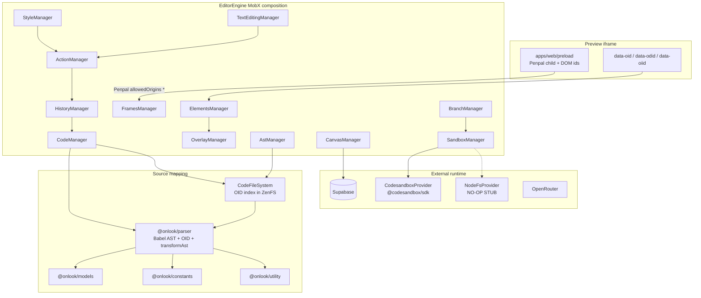

# Phase 00 — Validation report

**Status:** IN PROGRESS (founder approved Phase 0 exit option A on 2026-10-24; not PASS)  
**Scope:** Phase 0 Onlook research and reproduction preparation  
**allstudio branch:** `research/phase-0-onlook`  
**allstudio HEAD at branch creation:** `022b3524f08bd662fb83a5c763d300597e6a7cac`  
**Upstream:** https://github.com/onlook-dev/onlook  
**Verified baseline SHA:** `423e2e924366419e418ee049093872d535eea41a`  
**Research clone (outside both product Git repos):** `/Users/jabbo/AllStudio/research/onlook`  
**Environment:** macOS Darwin 27.0.0, Bun 1.3.14, Node v22.22.3, Docker 29.8.1 (daemon running)  
**Reviewer:** not yet assigned (human founder review required)  
**This report does not mark the phase PASS.**

## User-observable outcome

A contributor can reproduce a pinned Onlook revision, know which modules implement DOM ↔ JSX editing, and see either:

1. the original visual editor complete this loop: select a rendered element → resolve source → mutate text/style → inspect JSX/CSS diff → preview refresh, **or**
2. a documented blocker plus an isolated parser/source-edit spike that enables Phase 1.

Item 1 was **not** demonstrated. Item 2 was executed against `examples/nextjs-site-fixture/src/app/page.tsx`.

---

## What was inspected

Read in allstudio: `AGENTS.md`, `CLAUDE.md`, `HANDOFF_FOR_CLAUDE.md`, `RoadMap.md`, `ONLOOK_INTEGRATION.md`, `CODEBASE_ARCHITECTURE.md`, `docs/developer-setup.md`, `docs/provenance/README.md`, `@allstudio/editor` scaffold.

Read in Onlook at `423e2e924366419e418ee049093872d535eea41a`:

| Area | Paths |
|---|---|
| License / manifests | `LICENSE.md` (Apache-2.0, Copyright 2024 On Off, Inc.), root `package.json` (`packageManager: bun@1.3.1`), `bunfig.toml`, `README.md`, `CONTRIBUTING.md` |
| Docs | `docs/content/docs/developers/running-locally.mdx`, `architecture.mdx`, `self-hosting/external-services.mdx` |
| Parser | `packages/parser/src/**` including `parse.ts`, `ids.ts`, `code-edit/{transform,style,text,layout}.ts`, `template-node/map.ts`, tests |
| Editor engine | `apps/web/client/src/components/store/editor/engine.ts` and managers: `element`, `ast`, `code`, `style`, `text`, `history`, `action`, `canvas`, `overlay`, `frames`, `sandbox`, `branch` |
| Preview | `apps/web/preload/script/**`, `apps/web/client/public/onlook-preload-script.js`, `sandbox/preload-script.ts` |
| Filesystem | `packages/file-system/src/{fs,code-fs}.ts`, `packages/code-provider/src/providers/{nodefs,codesandbox}` |
| Models / constants | `packages/models/src/{code,element/templateNode}.ts`, `packages/constants/src/editor.ts` |
| Env | `apps/web/client/.env.example`, `apps/web/client/src/env.ts` |

REA was **not used**. Onlook is public Apache-2.0 source; this was ordinary repository inspection.

No Onlook source was copied into allstudio. The research clone is detached HEAD at the pinned SHA. The private `cloud/` repository was not modified.

---

## Source module / dependency map



### DOM selection and element mapping

- Preview assigns `data-odid` at runtime (`apps/web/preload/script/helpers/ids.ts`) and reads `data-oid` written into JSX.
- Click/hover lives in `ElementsManager`. Selection draws overlay rects; it does **not** parse source.
- `AstManager` maps `LayerNode.oid` → `CodeFileSystem.getJsxElementMetadata(oid)` (path, line/column tags, component name, extracted code snippet).
- Template map construction: `packages/parser/src/template-node/map.ts` (`createTemplateNodeMap`).

### JSX/TSX parsing and transformations

- `@onlook/parser` is `private: true`. Parser uses `@babel/standalone` (`packages/parser/src/packages.ts`).
- OID injection: `addOidsToAst` writes `data-oid` (`EditorAttributes.DATA_ONLOOK_ID = 'data-oid'`).
- Edits: `transformAst` applies `className` / props / text / structure actions keyed by oid.
- Style classes merge through `customTwMerge` (`code-edit/style.ts`). CSS→Tailwind for inspector edits is **not** in the parser; it is `apps/web/client/.../code/tailwind.ts` using `@onlook/utility`.
- Layout instrumentation: `injectPreloadScript` inserts the iframe bridge script into root layout.

### Canvas, layers, styles, selection

- `CanvasManager` is **not** a pure viewport: it imports `@/trpc/client` and `@onlook/db`.
- Layers: `ast/layers.ts` plus overlay state.
- Styles: `StyleManager` builds `update-style` actions, then `ActionManager.run` → history → code write + DOM dispatch.
- Frames: iframe views that call `processDom()` for layer trees.

### Live preview and browser communication

- `packages/penpal` + npm `penpal@^7`. Child methods are `apps/web/preload/script/api/**`.
- **Security gap (OBSERVED):** `WindowMessenger` uses `allowedOrigins: ['*']` with a `TODO: Use a proper origin` comment in `apps/web/preload/script/index.ts`.
- Preload is copied into the sandbox `public/` folder and injected into the Next layout (`sandbox/preload-script.ts`). Production CDN URL for deprecated scripts is referenced in parser tests (`cdn.jsdelivr.net/gh/onlook-dev/onlook@main/...`).

### History and undo/redo

- `HistoryManager` stores serializable `Action` objects. `push` writes code immediately. Undo inverts the action and `ActionManager.undo` writes again. PostHog is called from history.

### File reading, writing, and watching

- Browser project files: `@onlook/file-system` on **ZenFS / IndexedDB**, not a native folder.
- `CodeFileSystem.writeFile` injects OIDs, injects preload into root layout, formats with Prettier, and rebuilds the oid index (`code-fs.ts`).
- Native `NodeFsProvider` is a stub: `readFile` returns `''`, `listFiles` returns `[]`, `writeFile` returns `{ success: true }` without writing. Confirmed at this SHA.
- `SessionManager.start` **hardcodes** `CodeProvider.CodeSandbox` and calls `api.sandbox.start.mutate`. Local NodeFs is not wired into the editor.

### External sandbox and backend dependencies

Required by `apps/web/client/src/env.ts` to even boot the Next app:

- `CSB_API_KEY` (CodeSandbox)
- `OPENROUTER_API_KEY`
- `SUPABASE_DATABASE_URL`, `SUPABASE_SERVICE_ROLE_KEY`
- `NEXT_PUBLIC_SUPABASE_URL`, `NEXT_PUBLIC_SUPABASE_ANON_KEY`

Optional but documented for a “full” local product: Morph/Relace, Stripe, Freestyle, GitHub App, PostHog, Resend, Firecrawl, Exa, n8n, Langfuse.

Onlook README: this public repo is the earlier Next.js/Tailwind editor; the hosted early-access product is separate.

---

## Commands executed and results

| Command | Working directory | Result |
|---|---|---|
| `git clone https://github.com/onlook-dev/onlook.git` | `/Users/jabbo/AllStudio/research` | exit 0 |
| `git checkout 423e2e924366419e418ee049093872d535eea41a` | research clone | HEAD matches documented SHA. Commit: `fix(security): enforce project-membership authorization across all tRPC routers (IDOR) (#3129)`, 2026-07-22 |
| GitHub `get_commit` for that SHA | n/a | Confirmed on `onlook-dev/onlook` |
| `bun --version` / `node --version` / `docker info` | host | Bun 1.3.14, Node v22.22.3, Docker daemon running |
| `bun install` | research clone | exit 0; **2326 packages** in 7.13s. Bun 1.3.14 rewrote `bun.lock` (25 insertions / 328 deletions). **Lockfile restored** to the pinned SHA afterward. `node_modules` kept. |
| `bun test` | `packages/parser` | **93 pass, 0 fail**, 253 `expect()` calls, 320ms |
| `bun --filter @onlook/parser typecheck` | research clone | **exit 2**. `tsc` follows workspace packages into `apps/web/client` (`@/trpc/client` missing) and `@onlook/ai` / `@onlook/ui` JSX. Not a parser-unit failure; the package typecheck is not isolated. |
| `bun phase-0-experiment.ts` | `packages/parser` | exit 0. See verified functionality. |
| `bun backend:start` | research clone | exit 0. Supabase CLI reported **already running**. API URL `http://127.0.0.1:54321`, Studio `http://127.0.0.1:54323`. OAuth env vars unset. **Keys redacted; not copied into this repo.** |
| `bun run setup:env` | not run | Interactive; needs CodeSandbox and OpenRouter keys. **NOT RUN** (paid/external credentials; no founder authorization). |
| `bun db:push` / `bun db:seed` / `bun dev` | not run | Blocked on env. `CSB_API_KEY` and `OPENROUTER_API_KEY` are required strings in `env.ts`. |
| Full visual select→edit→preview | not run | Blocked. Session manager requires CodeSandbox. |

Parser tests that **do not** exist: `transformAst`, `addClassToNode`, `updateNodeTextContent`. Style/text mutation evidence is only the spike below.

---

## Verified functionality

### Parser unit tests (upstream)

`packages/parser` tests cover: parse round-trip, OID add/preserve/conflict, template-node maps (including array/conditional), preload script injection, Next config mutation, fragment helpers. **93/93 passed on this machine.**

### Isolated source-mapping spike (this session)

**NOT** the visual editor. A local bun script in the research clone (`packages/parser/phase-0-experiment.ts`, untracked, **not** copied into allstudio) did:

1. Parse `allstudio/examples/nextjs-site-fixture/src/app/page.tsx` (read-only; fixture was not written).
2. `addOidsToAst` → 5 template nodes.
3. Resolve the `hero-heading` `<h1>` by **tightest** source span containing `hero-heading` (first draft wrongly selected `<main>` because the parent span also contained the heading text).
4. `transformAst` with `{ className: "text-emerald-700", textContent: "Aurora Atelier — edited" }`.
5. Print generated JSX.

Observed heading result:

```text
resolved heading oid=2e-cz61 component=Home start=7:6 end=12:11
className="max-w-xl text-5xl leading-tight font-semibold tracking-tight text-emerald-700" data-oid="2e-cz61"
text: Aurora Atelier — edited
```

`text-zinc-950` was replaced by `text-emerald-700` via Onlook’s Tailwind merge. All JSX elements received `data-oid`. Babel `generate({ retainLines: true })` also moved some `>` tokens and appended `);` on the closing `</main>` line. Formatting is **not** a lossless round-trip.

Locator lesson (OBSERVED): source mapping in production must use the clicked element’s `data-oid`, not a text search over ancestor ranges. Onlook’s preload `getOid(node)` is the correct path.

### What was **not** verified

- Clicking a rendered element in Onlook’s canvas
- iframe / Penpal selection
- Preview refresh after a write
- Persistence through CodeSandbox or disk
- Undo/redo in the running app
- Electron
- `@allstudio/editor` doing any of the above (still a scaffold)

---

## Known limitations and blockers

| Item | Evidence | Impact |
|---|---|---|
| Full Onlook app cannot boot without secrets | `env.ts` requires CodeSandbox + OpenRouter + Supabase keys | Visual E2E **BLOCKED** without founder-authorized keys. No paid calls were made. |
| Preview always uses CodeSandbox | `SessionManager.start` hardcodes `CodeProvider.CodeSandbox` | Cannot point the unmodified editor at a local Next fixture. |
| `NodeFsProvider` is a stub | `packages/code-provider/src/providers/nodefs/index.ts` | Confirms `ONLOOK_INTEGRATION.md`. Local-first allstudio **must implement** a real workspace adapter (Phase 2), not reuse this class as-is. |
| EditorEngine is an app singleton | Imports PostHog, Branch, CodeFileSystem, 20+ managers; `activeSandbox` via branches | Not an npm library. Cannot drop into `@allstudio/editor`. |
| Canvas/sandbox couple to tRPC + DB | `canvas/index.ts`, `sandbox/session.ts` | Do not extract those files without replacing remote calls. |
| Insecure Penpal origin | `allowedOrigins: ['*']` | Must harden before any untrusted preview. |
| Parser undeclared deps | `prettier/standalone` used by `formatContent`; `@onlook/constants` and `@onlook/utility` imported though `package.json` only lists `@onlook/models` + Babel | Extraction must declare real dependencies. Circular: `utility` → `fonts` → `parser`. |
| OID written into user source | `addOidsToAst` persists `data-oid` | Product decision: keep Onlook’s in-source markers, or use a sidecar index that is stripped on export. |
| Babel generate reformats | spike diff | Need Prettier (`formatContent`) or a different printer before claiming formatting preservation. |
| Parser `typecheck` is not isolated | tsc walks sibling packages | Do not treat `bun --filter @onlook/parser typecheck` as a parser health signal. Use `bun test`. |
| Hosted Onlook ≠ this repo | README waitlist / early-access note | Do not assume current onlook.com behavior matches this SHA. |
| Assets / trademarks | Root Apache-2.0 does not grant Onlook branding or every bundled image/font | Do not copy `assets/`, UI illustrations, or the name “Onlook”. `@onlook/fonts` is metadata/helpers, still needs an asset-level review before redistribution. |
| Bun version | Upstream pins 1.3.1; this machine used 1.3.14 and rewrote the lockfile | Already a recorded provisional allstudio decision. Use the restored upstream lockfile for Onlook research. |

Local Supabase was already running on this machine. This report did not start a clean empty backend, did not run `db:push`/`db:seed`, and did not stop the existing stack.

---

## Proposed extraction approach

v0.2 `CODEBASE_ARCHITECTURE.md` limits public packages to `@allstudio/editor`, `@allstudio/project`, `@allstudio/protocol`. That supersedes the larger package list in `ONLOOK_INTEGRATION.md` §5.1 for V1.

**Smallest reusable portion for an initial working editor inside existing `@allstudio/editor`:**

1. **Parser core (extract/adapt, Apache-2.0):**  
   `packages/parser/src/{parse,ids,packages,helpers,code-edit/transform,style,text,helpers,template-node/**}`  
   plus the **minimum** types from `@onlook/models` (`TemplateNode`, `CodeDiffRequest`, `CodeDiff`) and `EditorAttributes` from `@onlook/constants`. Reimplement `createOid` / `customTwMerge` as local helpers instead of importing all of `@onlook/utility` (which pulls fonts and more).
2. **Typed facade in `@allstudio/editor`:** `locateSource(file, oid)`, `previewPatch(file, request)`, `applyPatch` that returns `{ original, generated }` — matching `processGroupedRequests` in `code/requests.ts` without MobX or tRPC.
3. **Do not extract yet:** `EditorEngine`, sandbox, branch, chat, git, theme, font upload, screenshots, `@onlook/ui`, Supabase, CodeSandbox, ZenFS `FileSystem`.
4. **Preview bridge (Phase 1 follow-on, after parser tests):** `apps/web/preload` + a **hardened** Penpal parent. Replace `allowedOrigins: '*'`. Serve the preload from allstudio, not jsDelivr.
5. **Workspace writes (Phase 2):** implement `ProjectWorkspace` against real disk. Ignore `NodeFsProvider`.

Provenance for every copied file: upstream URL + SHA `423e2e924366419e418ee049093872d535eea41a` + path + destination + modification summary (`docs/provenance/README.md`). Keep Apache-2.0 notices; note changes in modified files. Do not use Onlook trademarks.

### Recommended Phase 1 slice (after founder gate)

Port parser + minimal models into `@allstudio/editor` (or a `src/source-mapper/` module inside it). Add fixture tests on `examples/nextjs-site-fixture`:

- inject oids
- locate `hero-heading`
- text edit
- className merge
- refuse/preserve dynamic expressions
- formatting / no-op round-trip

Do **not** start Electron.

---

## Recommendations for Claude Code

1. Treat `/Users/jabbo/AllStudio/research/onlook` at SHA `423e2e924366419e418ee049093872d535eea41a` as the only Onlook evidence source. Do not clone `onlook-dev/desktop` unless a later task asks.
2. Do not copy the Onlook tree into allstudio. Copy individual files with provenance.
3. Start with `@onlook/parser` tests as regression oracles; add `transformAst` tests (upstream has none).
4. Use DOM `data-oid` for selection. Do not locate nodes by searching ancestor source text.
5. Keep `data-oid` out of exported production sites unless the founder chooses in-source markers (decision below).
6. Replace CodeSandbox with allstudio preview later; do not implement NodeFs as a silent no-op.
7. Harden iframe messaging before connecting an untrusted preview.
8. Do not import `@onlook/ui`, PostHog, tRPC, or `@onlook/db` into the public editor.
9. Parser `typecheck` is currently meaningless in isolation; rely on `bun test` plus new allstudio tests.
10. Stop if a product choice is unset; ask. Do not invent marker vs sidecar, MobX vs existing editor state, or Bun 1.3.1 vs 1.3.14.

---

## Tests still required

- [ ] Human reproduction of the parser spike (command in this report).
- [ ] Fixture tests for `transformAst` text + className + conditional/expression refusal.
- [ ] Prettier/`formatContent` vs Babel-only generate on the same fixture.
- [ ] Preload origin checks and `data-oid` ↔ `data-odid` pairing (needs a preview host; not CodeSandbox unless authorized).
- [ ] Hash/conflict (`expectedSha256`) when the file changed under the editor.
- [ ] Public-boundary scan after any extraction (`bun run validate:public-boundary`).
- [ ] Full Onlook UI E2E **only if** founder authorizes CodeSandbox + OpenRouter keys (or a later local sandbox).
- [ ] Independent review of extracted files (license + behavior).

---

## License and provenance

| Field | Value |
|---|---|
| Upstream repository | https://github.com/onlook-dev/onlook |
| Stars (observed 2026-10-25) | 27,003 |
| License | Apache-2.0 (`LICENSE.md`; package.json `license: Apache-2.0` on inspected packages) |
| Copyright notice | Copyright 2024 On Off, Inc. |
| Pinned commit | `423e2e924366419e418ee049093872d535eea41a` |
| Files copied into allstudio | **none** |
| New third-party libraries adopted | **none** |

Additional concerns: iframe script from jsDelivr in tests; Penpal `*`; PostHog/Gleap/RB2B in the web client; CodeSandbox SDK; Freestyle; Stripe. None of those belong in the first parser extraction.

---

## Founder decisions

**Phase 0 exit (2026-10-24):** option **A**. Recorded in `docs/decisions/ADR-0002-phase-0-exit.md`.

The visual loop cannot be shown in unmodified Onlook without CodeSandbox and OpenRouter credentials. The isolated parser spike locates the fixture heading and emits a JSX diff. Phase 1 extraction into `@allstudio/editor` may begin. Full Onlook UI remains optional later.

**`data-oid` persistence:** Phase 1 uses in-source `data-oid` during editing (Onlook-like). Stripping on production export is deferred.

Agents still must not mark this phase PASS.

---

## Fixtures and manual reproduction steps

Parser tests:

```bash
cd /Users/jabbo/AllStudio/research/onlook
git rev-parse HEAD   # expect 423e2e924366419e418ee049093872d535eea41a
cd packages/parser
bun test
```

Spike (research clone only; does not modify the fixture on disk):

```bash
cd /Users/jabbo/AllStudio/research/onlook/packages/parser
bun phase-0-experiment.ts
```

Expect: `oid injection modified AST: true`, heading `component=Home`, generated class list includes `text-emerald-700`, text `Aurora Atelier — edited`.

---

## Automated checks

| Check | Result |
|---|---|
| Onlook `packages/parser` `bun test` | PASS 93/93 |
| Isolated parser spike | PASS (no preview) |
| Onlook web `bun dev` | NOT RUN |
| allstudio lint/typecheck/test | NOT RUN this session (scaffold unchanged) |
| Independent review | NOT RUN |

## Integration / E2E evidence

- Parser spike stdout captured 2026-10-24 in this session (heading oid, className merge, text replacement).
- No screenshots of Onlook UI.
- Fixture file on disk was not modified.

## Negative and recovery cases tested

- First spike locator selected `<main>` (false positive). Fixed by tightest span containing `hero-heading`. Documented so Phase 1 does not repeat it.
- Parser tests include malformed next.config (handled) and invalid oid replacement.

## Regression checks from previous phases

None. Phase 0 is the first gate.

## Security, privacy, performance, accessibility observations

- Penpal `allowedOrigins: ['*']` is unsafe for untrusted previews.
- Supabase keys printed by a local `supabase start` on this machine were **not** stored in git. Rotate if they were ever shared.
- No allstudio/cloud code or secrets were read for this report.
- Accessibility of Onlook UI: not evaluated (app not run).

## Known limitations and unresolved defects

See blockers table. Remaining product decisions: Bun version (already listed in HANDOFF); `data-oid` strip-on-export deferred.

## Gate recommendation

**IN PROGRESS** — founder accepted option A on 2026-10-24 (`ADR-0002`). Isolated source mapping is evidenced; unmodified Onlook visual E2E remains blocked. **Not PASS.**

---

## Delivery record

**Roadmap phase / acceptance criterion:** Phase 0 — reproduce Onlook baseline or document blocker + parser spike  
**Founder approvals or unresolved decisions:** Phase 0 exit **A** (2026-10-24). `data-oid` in-source during edit (Phase 1 default). Bun 1.3.1 vs 1.3.14 still provisional.  
**OSS candidates:** `onlook-dev/onlook` https://github.com/onlook-dev/onlook — 27,003 stars on 2026-10-25, Apache-2.0, already the approved upstream. No new library proposed.  
**REA:** not applicable; public source inspected. Not available for this task’s needs.  
**Files changed and visible result:** this report only in allstudio. Research clone + untracked experiment script outside product repos.  
**Tests run:** `bun test` in Onlook `packages/parser` (93 pass); `bun phase-0-experiment.ts` (exit 0).  
**Real-world proof:** JSX diff on the Aurora Atelier fixture heading, without preview.  
**Negative/security/regression checks:** ancestor-oid false positive; Penpal origin gap; NodeFs no-op; env secret requirements.  
**Not run, failures, and risks:** Onlook `bun dev`, db:push, iframe E2E, parser typecheck isolation, Electron.  
**Gate recommendation:** IN PROGRESS / READY FOR HUMAN VALIDATION of the spike — **not PASS**
